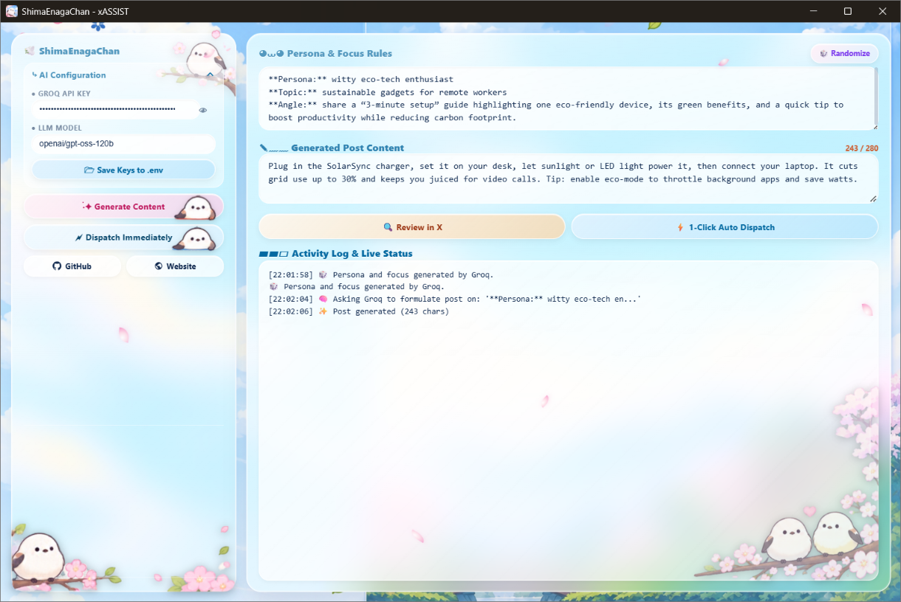
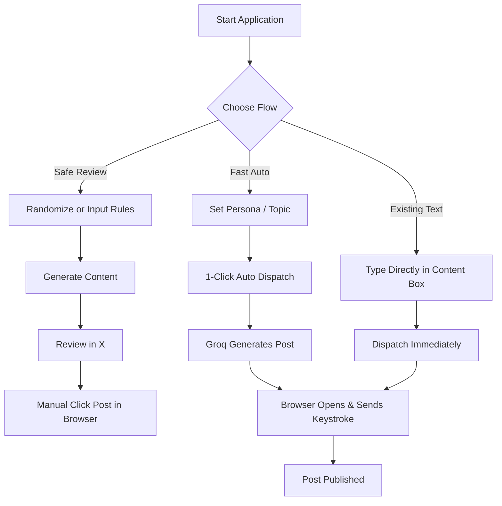

<div align="center">

# 🕊️ ShimaEnagaChan - xASSIST

**An aesthetic desktop assistant for generating, refining, and dispatching X (formerly Twitter) posts using Groq LLMs.**

[](https://www.python.org/)
[](https://groq.com/)
[](https://pywebview.flowrl.com/)
[](https://microsoft.com/windows)
[](LICENSE)

<br />



</div>

---

## 📖 Overview

**ShimaEnagaChan - xASSIST** is a lightweight Windows desktop client featuring an adorable Shima Enaga (Japanese long-tailed tit) glassmorphism interface. Powered by high-speed inference via the **Groq Cloud API**, it streamlines post generation, character limit validation, and automated or semi-automated publishing directly through X’s Web Intent interface.

Whether you want complete control with manual reviews or a swift 1-click dispatch pipeline, xASSIST adapts to your content management flow while keeping your credentials secure on your local machine.

> ⚠️ **Disclaimer:** This application provides automation features (browser orchestration and keystroke emulation). Please review all generated drafts prior to submission and respect [X's Automation Rules](https://help.twitter.com/en/rules-and-policies/x-automation-rules). Use this tool responsibly.

---

## ✨ Features

- **⚡ Blazing Fast Generation:** Leverages Groq's low-latency API to draft 280-character posts in milliseconds.
- **🎲 Dynamic Persona Randomizer:** Automatically spins fresh writing styles, topics, and angles when creativity runs dry.
- **🛡️ Secure Local Storage:** API keys and preferred models are persisted locally in a `.env` configuration file beside the app.
- **📏 Built-in Post Validation:** Interactive character counter strictly monitors the 280-character boundary.
- **🎯 Multi-tier Dispatch Pipelines:**
  - **Manual / Review Mode:** Pre-fills post contents in your browser via X Web Intent for manual verification and publishing.
  - **Auto Dispatch:** Seamlessly loads, focuses, submits via keystrokes (`Ctrl + Enter`), and cleans up the browser tab automatically.
- **🌸 Handcrafted Aesthetic:** Soft pastel glassmorphic UI built with web standards and rendered natively using `pywebview`.

---

## 📥 Download

Download the latest Windows build from
[**GitHub Releases**](https://github.com/rahuldas75/ShimaEnagaChan-xASSIST/releases/latest).

> **Note:** Windows may display a security warning for unsigned executables.
> Only download builds from this official repository.

---

## 🗂️ Project Structure

```text
ShimaEnagaChan-xASSIST/
│
├── .env.example.txt            # Template for local environment variables
├── .gitignore                  # Git untracked rule definitions
├── dispatcher.py               # Browser orchestration & dispatch routines
├── LICENSE                     # Open-source license terms
├── main.py                     # App entry point, pywebview API & Groq client logic
├── README.md                   # Project documentation
├── requirements.txt            # Python dependencies
├── ShimaEnagaChan.spec         # PyInstaller build specification
│
└── ui/
    ├── index.html              # Frontend layout and interactive scripts
    └── assets/
        ├── bg.png              # Background illustration
        ├── shima-enaga-icon.ico# Application system icon
        ├── shima-enaga-icon.png# High-res branding icon
        ├── ui-screenshot.png   # Documentation UI preview
        └── *.png               # Mascot sprites and visual assets
```

---

## 🛠️ Tech Stack & Requirements

- **Backend:** Python 3.10+
- **Desktop Wrapper:** `pywebview`, `pythonnet` (Edge Chromium backend)
- **Inference Engine:** `groq` SDK
- **Automation & Dispatch:** `PyAutoGUI`, `PyGetWindow`, native Web Intents
- **Environment Management:** `python-dotenv`

---

## 🚀 Getting Started

### 1. Clone the Repository

```bash
git clone https://github.com/rahuldas75/ShimaEnagaChan-xASSIST.git
cd ShimaEnagaChan-xASSIST
```

### 2. Create a Virtual Environment

```bash
python -m venv venv

# Windows (Command Prompt)
venv\Scripts\activate.bat

# Windows (PowerShell)
venv\Scripts\Activate.ps1
```

### 3. Install Dependencies

```bash
pip install -r requirements.txt
```

### 4. Configure Environment Variables

Create a `.env` file in the root directory by copying `.env.example.txt`:

```bash
copy .env.example.txt .env
```

Set your values inside `.env` or input and save them directly inside the GUI:

```env
GROQ_API_KEY=gsk_your_groq_api_key_here
LLM_MODEL=llama-3.3-70b-versatile
```

### 5. Launch the Application

```bash
python main.py
```

---

## 🎛️ Control Panel & Button Reference

| Button / Control | Description |
| :--- | :--- |
| **👁 Show / Hide Key** | Toggles password-masking for the Groq API key field without modifying content. |
| **📁 Save Keys to `.env`** | Writes the current `GROQ_API_KEY` and `LLM_MODEL` to the local `.env` file beside the binary. |
| **🎲 Randomize** | Requests a creative combination of Persona, Focus Topic, and Writing Angle from Groq. |
| **✦ Generate Content** | Ingests current **Persona & Focus Rules** and populates **Generated Post Content** (capped at 280 chars). |
| **🔍 Review in X** | Launches the browser with your drafted post pre-filled in the composer for manual editing and publishing. |
| **⚡ 1-Click Auto Dispatch** | Generates new content from your rules, opens X, issues `Ctrl + Enter`, and closes the tab automatically. |
| **⚡ Dispatch Immediately** | Takes whatever is **currently** inside the post box and runs the immediate submission macro. |

---

## 🔄 User Workflows



### 1. Manual & Safe Flow (Recommended)
1. Write or click **Randomize** to generate rules.
2. Click **Generate Content**.
3. Refine or edit the drafted text directly in the text area.
4. Click **Review in X** to inspect the post within your default browser, then manually click **Post**.

### 2. Fully Automatic Pipeline
1. Provide a persona rule or topic angle.
2. Click **1-Click Auto Dispatch**.
3. The app generates the draft, opens the intent URL, dispatches it via keyboard automation, and gracefully closes the browser tab.

### 3. Existing Text Flow
1. Paste or draft your own post inside **Generated Post Content**.
2. Click **Dispatch Immediately** to fire the browser submission macro without re-generating text.

---

## 📦 Building the Executable (.exe)

You can package the application into a standalone Windows binary using **PyInstaller**:

### Option A: Using the `.spec` File (Recommended)

Since the project includes `ShimaEnagaChan.spec` preconfigured with data bindings and hooks:

```bash
python -m PyInstaller --clean ShimaEnagaChan.spec
```

---

### Option B: Building Directly from CLI (Without `.spec`)

To build a single-file portable `.exe` with all dependencies and hooks resolved on the fly:

```bash
python -m PyInstaller --noconsole --onefile ^
  --collect-all webview ^
  --collect-all groq ^
  --collect-all pyautogui ^
  --collect-all pygetwindow ^
  --hidden-import "clr" ^
  --hidden-import "dispatcher" ^
  --hidden-import "dotenv" ^
  --add-data "ui;ui" ^
  --icon="ui/assets/shima-enaga-icon.ico" ^
  --name "ShimaEnagaChan" ^
  --clean main.py
```

> **Note:** The compiled binary will be placed inside the `dist/` directory (`dist/ShimaEnagaChan.exe`). Place your `.env` file beside the generated `.exe` to allow automatic key loading.

---

## 🔐 Security & Privacy

- Store your Groq API key in `.env` or another secure local configuration mechanism.
- Ensure `.env` is listed in `.gitignore`.
- Never publish API keys, access tokens, or personal data in issues, screenshots, or commits.
- Generated content may be sent to Groq for processing; avoid including confidential information in prompts.
- Browser automation operates within your local desktop session. Keep your device and browser session secure.

## ⚠️ Limitations & Responsible Use

- This project relies on UI and keyboard automation, which may fail due to focus changes, browser updates, display scaling, or timing differences.
- X Web Intent prepares content in X; it is not an official X Developer API integration.
- One-click dispatch depends on browser focus and UI automation; it does not guarantee successful delivery.
- You are responsible for reviewing content and complying with [X's Terms of Service](https://x.com/en/tos) and [Automation Rules](https://help.x.com/en/rules-and-policies/x-automation).

---

## 🛠️ Troubleshooting

| Issue | Suggested check |
| --- | --- |
| `GROQ_API_KEY` not detected | Confirm `.env` exists, the key name is exact, and the app loads environment variables. |
| Dependency installation fails | Verify Python version and run `python -m pip install --upgrade pip`. |
| Browser does not open | Check your Windows default browser settings. |
| Automation targets the wrong window | Close unrelated windows and ensure the browser is visible before dispatch. |
| Executable fails to launch | Run `python main.py` first to identify errors; check PyInstaller asset and hidden-import requirements. |

If an issue persists, open a GitHub issue with the error message and steps to reproduce. **Do not include secrets or API keys.**

---

## 📄 License

This project is distributed under the **MIT License**. See [`LICENSE`](LICENSE) for the full license text.

---

## 🙌 Acknowledgements

- [Groq](https://groq.com/) for LLM inference.
- [X Web Intent](https://x.com/intent/post) for the post-composer interface.
- The open-source Python ecosystem powering the desktop application.

---

## 🤝 Contributing

Contributions, issues, and feature requests are welcome!

1. Fork the project.
2. Create your feature branch (`git checkout -b feature/NewFeature`).
3. Commit your changes (`git commit -m 'Add NewFeature'`).
4. Push to the branch (`git push origin feature/NewFeature`).
5. Open a Pull Request.

---

## 📄 License

Distributed under the **MIT License**. See [`LICENSE`](LICENSE) for more details.